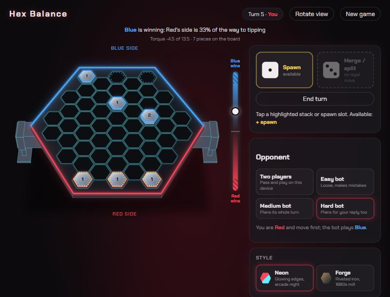

# Hex Balance

**Status: playable prototype.** You can play it against a bot (easy, medium or hard), hot-seat on one device, or online between two devices. The rules are reconstructed from memory and still change as it gets played.

**Live:** https://hex-balance.vercel.app



Hex Balance is a browser recreation of a two-player balance game that Zach Shirley and a friend built in a high-school metalworking class. The board was a hexagonal steel plate resting on a square pipe across its middle. Each player owns the half on their side of the pipe, and you roll dice to add, move, merge and knock over stacks of steel pieces. Weight far from the pipe counts more. If the plate tips toward you, you lose. "Hex Balance" is a working title, because nobody remembers what the original was called.

## How to play

- On your turn, roll two dice. Each die is one action, and you use them in any order:
  - 1: spawn
  - 2: move or jump
  - 3: merge or split
  - 4: strike
  - 5: reinforce
  - 6: wild
- Doubles trigger combos. Some help (Stampede gives four moves). Some hurt (Snake eyes forces three spawns on your own edge).
- Tap a highlighted stack to pick it up and see where it can go, or tap a spawn slot to spawn. The meter beside the board shows how close each side is to tipping, and hovering a move previews where the meter would land. Dice with no legal move are skipped automatically.
- **Opponent:** two players on one device, or an Easy, Medium or Hard bot. Against a bot you play Red and move first.
- **Online:** **Create online room** gives you an invite link for a friend on another device.
- **Style:** Neon (default) or Forge.
- **Settings and experiments:** plate mass, starting pieces, forced moves, three dice, overheating spawns, a hidden "breaking point" tower height, and a piece limit.

The full rules and combo table are in the in-game **Rules** panel.

## Run locally

```bash
npm install
npm run dev     # http://127.0.0.1:5340
npm test        # rules and bot tests (Vitest)
npm run build   # typecheck + production bundle
```

## Deployment

Hosted on Vercel at https://hex-balance.vercel.app. Pushes to `main` on GitHub (https://github.com/Zach-Shirley/hex-balance) deploy to production automatically through Vercel's Git integration. It is a static Vite build, with no backend of its own.

## Verification

**Automated tests:** 35 Vitest tests.
- `tests/rules.test.ts` covers:
  - board geometry and neighbours;
  - the balance and tipping maths;
  - every action type, combos, passing and forced dice;
  - overheat, and the breaking point (one shared hidden limit; only growing a tower can break it).
- `tests/bot.test.ts` checks that:
  - each bot level plays only legal moves through whole games, including with experiments on;
  - each bot takes a win when one is there;
  - no bot tips the board toward itself when it has a safe choice;
  - a bot with no pieces spawns instead of passing.

**Simulations:**
- The engine was fuzzed with about 87,000 random actions to check the breaking-point rule; it never let a tower stand above the limit.
- The bots were checked with bot-vs-bot tournaments:

| Matchup (default settings, alternating colours) | Result |
| --- | --- |
| Medium vs Easy | 27–3 |
| Hard vs Medium | 20–9 |
| Medium vs a scripted "rusher" (build one tall stack and march it across) | 30–7 |
| Hard vs the rusher | 23–6 |

**Checked by hand in a desktop browser:**
- local play against each bot level;
- the online room in two tabs, locally and on the live site;
- the phone-width layout, in a 375 px emulated viewport.

**Not tested:**
- online play between two different home networks;
- real phones and tablets (only emulated);
- the bots against people other than Zach (Zach did beat an earlier Medium; that led to the current version);
- the bots under three dice, breaking point and forced moves since the latest bot revision. In an earlier version, Hard's edge over Medium nearly disappeared with three dice (6–5).

## Known limitations

- The rules are a best-effort reconstruction. Die 4 (strike) is a guess, and the movement, spawning and starting-piece details are assumptions (see the table below).
- **Online play** has no accounts and no server of its own. It uses PeerJS's free public servers, so it depends on their uptime. The host's tab must stay open, and the guest has to trust the host's dice.
- **The bots** play Blue only. They are tuned against each other, not against people. On big combo turns they think for up to about 2 seconds.
- Some chunks of the production bundle are over 500 kB. The archived 3D style (below) accounts for most of that, and it only loads if that style is enabled.

## How it was built

Zach described the original game from memory: the board, the pivot, the dice meanings and how the balance worked. He supplied a photo of the etched plate, from which the 52-cell layout was counted.

| Element | Source |
| --- | --- |
| 52-cell board: 9 columns of 2, 5, 8, 7, 8, 7, 8, 5, 2 flat-top cells | Counted from Zach's photo of the plate |
| Pivot on a square pipe across the middle; tipping toward you loses | Zach's description |
| Three spawn slots on each player's outer edge | Zach's description |
| Roll two dice and use each one as an action | Zach's description |
| 1 spawn, 2 move, 3 merge, 5 reinforce, 6 wild | Zach's recollection |
| 4 = strike (knock one piece off an adjacent enemy stack) | Zach's best guess; unconfirmed |
| Enemy stacks on your spawn slots block spawning | Zach's description |
| Move = one step, or jump over one adjacent stack | Assumed (combines the remembered "move" and "jump") |
| Spawn may add to your own stack on a spawn slot | Assumed |
| One starting piece per spawn slot | Assumed |
| Tipping model and default weights | Assumed; tuned by simulation (below) |

From there, the game grew through rounds of Zach playing it and giving direction:
- the angled 3D-style view;
- online play so two devices could play;
- shake as the plate nears tipping;
- combos as a core rule, and merge/split on the 3;
- the experiments;
- two visual styles;
- the single-player bots.

**Locked rules (2026-10-15):**
- Pipe half-width 0.5 and plate mass 20.
- Doubles combos are core: 11 Snake eyes, 22 Stampede, 33 Weld, 44 Convert, 55 Supply drop, 66 Jackpot.
- 3 is merge or split.
- Online, only the host changes settings.

**Weight model:** each piece weighs 1, and a stack's torque is its piece count times its distance from the pipe in cell heights. The plate rests on the flat top of a square pipe, so it tips once the combined centre of mass passes the pipe's edge:

```
|Σ pieces × distance|  ≥  pipeHalfWidth × (plateMass + total pieces)
```

A physical estimate of the real plate (about 145 piece-weights, half-width about 0.42) almost never produced a finished game in greedy-bot playtests, because the two sides kept cancelling each other out. The lighter plate keeps games to around 14 rounds; at mass 20, 86% of greedy-bot games finished.

**The bots** (`src/bot.ts`) play through the same rules engine as people. They try the action sequences their dice allow and score each resulting board on four things:
- the balance now;
- how much push each side's pieces still have as they advance;
- the odds, over every possible next roll (including forced combos), that someone can tip the board;
- having pieces in play at all.

Easy plays one die at a time and is often random. Medium plans its whole turn. Hard also checks every possible opponent reply roll. The bots run in a Web Worker so the board keeps animating.

**Archived style:** a 3D "Foundry" arena (Three.js) was built and then archived on 2026-10-19. Its code is kept in `src/scene3d.ts` and at git tag `foundry-archive`.

## Code

- `src/board.ts`: board geometry, neighbours, spawn slots, lever arms
- `src/rules.ts`: game state, legal actions, dice, combos, balance and tipping (pure, no DOM)
- `src/view3d.ts`: 2.5D projection of the plate, pipe and stacks
- `src/bot.ts`, `src/botWorker.ts`: single-player bots and the worker they run in
- `src/net.ts`: PeerJS host/guest sessions
- `src/main.ts`, `src/style.css`: UI, dice panel, balance meter, animation, panels
- `src/scene3d.ts`: archived 3D style

## AI assistance and Zach's role

The code was written with an AI coding agent (Claude Code). Zach's part:
- He supplied the original game, the board photo and the rule recollections.
- He made the design calls: the pipe width, combos as core, which experiments to try, the visual direction, and archiving the 3D style.
- He playtested and reported problems. The breaking point felt inconsistent, the board vanished, and the Medium bot never spawned and lost to a tall-stack rush. Each report led to a fix.

The agent did the implementation, the tests, the simulations and the bot tuning.

## Attribution

- Fonts are loaded from Google Fonts, under their open licenses.
- Libraries:
  - PeerJS (MIT) for online play;
  - Three.js (MIT) for the archived 3D style;
  - Vite, TypeScript and Vitest for building and testing.
- No third-party art assets are used.

## License

No license yet. All rights reserved; the source is public to read.
